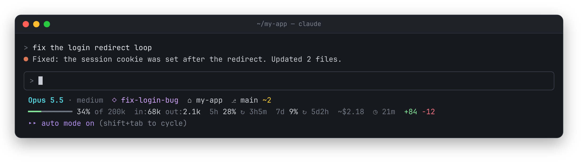
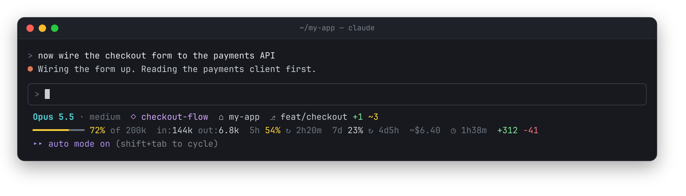
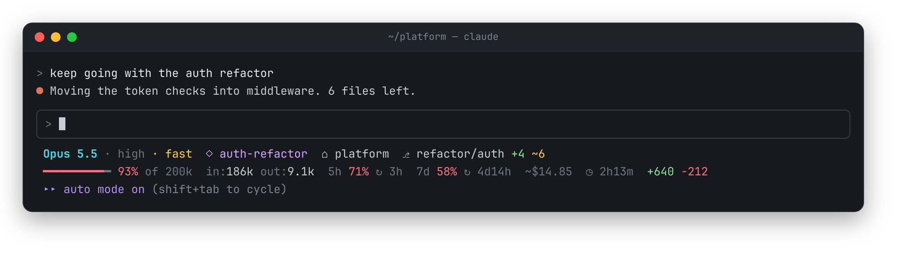
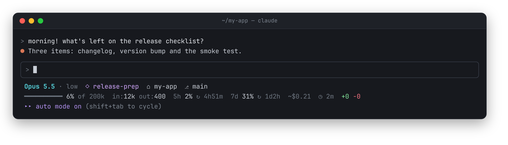
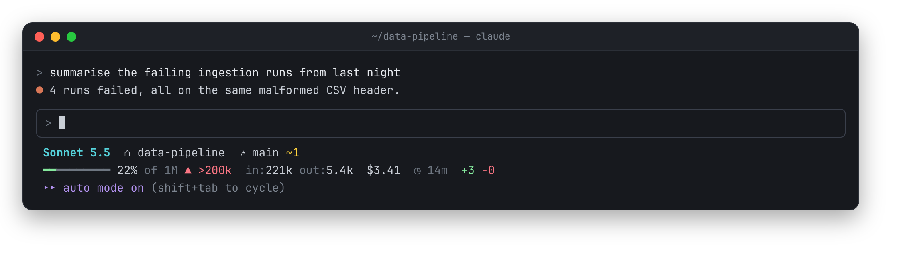
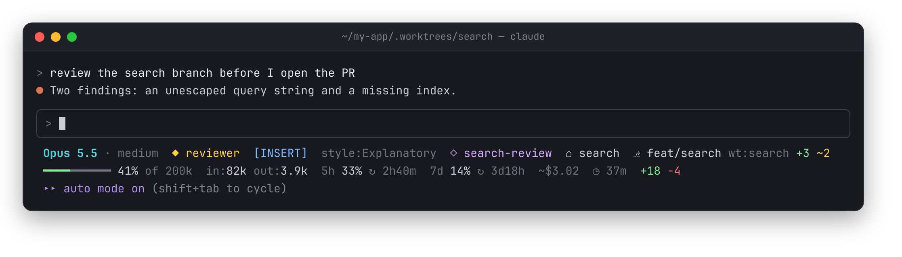
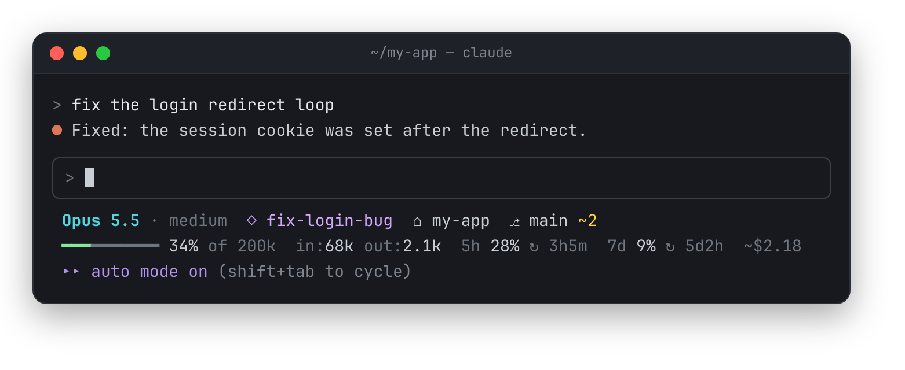

# claude-statusline

A fast, two-line status line for [Claude Code](https://code.claude.com/docs/en/statusline) that tells you how much room you have left: context, rate limits and the time until they reset.



## Scenes

**Getting close.** Context passes 70% and the 5-hour limit is being used about as fast as time passes, so both turn yellow. The countdown says how long until the limit resets.



**Slow down.** Context is past 90% and both limits are burning much faster than their windows, so you'd run out before the reset. Everything that needs attention is red.



**Fresh window.** The 5-hour limit just reset. The weekly limit is at 31% with a day left, which is well under pace, so it stays plain.



**API key.** No subscription limits, so those parts don't appear, and the cost is real money, so it's shown at full strength. `▲ >200k` warns when a 1M-context session passes 200k tokens.



**Worktree, agent and vim.** Shows the agent, vim mode, output style and the linked worktree next to the branch, with staged and modified counts.



**Narrow terminal.** At 80 columns, duration and lines changed drop first instead of wrapping.



## Features

- **Reset countdowns.** `5h 30% ↻ 2h13m` shows how much of the 5-hour limit is used and how long until it resets. The weekly limit gets the same.
- **Pace warning.** A limit turns yellow when you're using it faster than time is passing, and red when you'll run out well before the reset. Low usage and the start of a window don't warn, because pace is too noisy there.
- **Live across sessions.** Sessions on the same account share their latest limit readings, so an idle session still shows usage from your other sessions.
- **Text icons, not emoji.** Thin symbols that take the colour of the text around them and stay one cell wide.
- **Colour only when it matters.** Labels are dim, values are plain, and yellow or red means something needs attention.
- **Fits narrow terminals.** The least important parts drop first instead of wrapping.
- **Fast.** One `jq` call and one cached `git status` per refresh, about 20 ms.

## What each part means

**Line 1:** model, effort level, `fast` when fast mode is on, agent (`◆`), vim mode, output style, session name (`◇`), folder (`⌂`), extra project dir and added dirs, then the git branch (`⎇`) with the worktree name, staged (`+`) and modified (`~`) counts.

**Line 2:**

| Part | Meaning |
|---|---|
| `━━━━━━━━━━ 55% of 200k` | Context window used. Green, then yellow at 70%, red at 90%. `▲ >200k` appears past 200k tokens. |
| `in:110k out:3.2k` | Input and output tokens in the context window. |
| `5h 30% ↻ 2h13m` | 5-hour limit used, and time until it resets. |
| `7d 12% ↻ 4d5h` | Weekly limit used, and time until it resets. |
| `~$4.12` | Session cost. On a Pro or Max plan it's a list-price estimate, so it's dimmed and marked `~`. With an API key it's shown at full strength. |
| `◷ 25m` | Session duration. |
| `+120 -7` | Lines added and removed. |

The limits only appear on Pro and Max plans.

**Limit colours.** Pace compares how much of a limit you've used with how much of its window has passed. Yellow means you're on pace to hit the limit before it resets (at 25% used or more), or you're at 75%. Red means you'd run out well before the reset (at 50% used or more), or you're at 90%. Nothing is coloured in the first 10% of a window.

**Other sessions.** Claude Code only sends a session new limit numbers when that session gets a reply. So each session writes what it last saw to `~/.cache/claude-statusline/`, one file per config directory, and every session shows the newest reading. That's why `refreshInterval` matters: it re-runs the script every minute, which lets an idle session pick up usage from your other sessions. Separate accounts with separate `CLAUDE_CONFIG_DIR`s never mix.

When the terminal is narrow, parts drop in this order:

- line 1: added dirs, output style, project dir, session name, agent, vim mode, git
- line 2: duration, lines changed, weekly limit, tokens, cost

The model, folder, context bar and 5-hour limit always stay.

## Requirements

- bash 3.2+ (the bash that ships with macOS is fine)
- `jq` 1.6+: `brew install jq` on macOS, `sudo apt install jq` on Debian/Ubuntu
- `git` 2.11+

## Install

```bash
curl -fsSL https://raw.githubusercontent.com/TahrimWalid/claude-statusline/main/statusline.sh -o ~/.claude/statusline.sh
chmod +x ~/.claude/statusline.sh
```

Then add this to `~/.claude/settings.json`:

```json
"statusLine": {
  "type": "command",
  "command": "~/.claude/statusline.sh",
  "padding": 1,
  "refreshInterval": 60
}
```

`refreshInterval` re-runs the script every minute so the countdowns keep ticking, and usage from your other sessions shows up, while the session is idle. Start a new Claude Code session to see it.

## Preview

`preview.sh` renders a few sample sessions with your current directory as the git part, so you can check how it looks in your terminal and font:

```bash
./preview.sh
```

The images in this README come from `docs/render.py`, which runs the real script on sample sessions and screenshots the output. To regenerate them after changing the script:

```bash
docker build -t claude-statusline-render docs
docker run --rm -v "$PWD":/repo -w /repo claude-statusline-render python3 docs/render.py
```

## Credits

Started as a rewrite of the status line in [itsrafsanjani/.claude](https://github.com/itsrafsanjani/.claude).

## License

[MIT](LICENSE)
